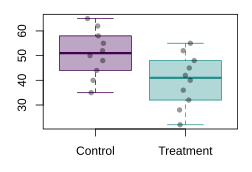
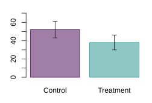
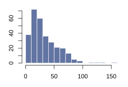
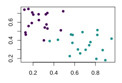
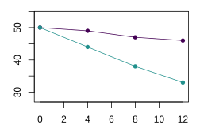
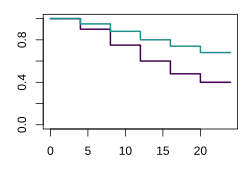
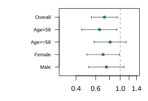
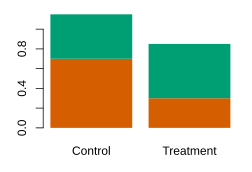
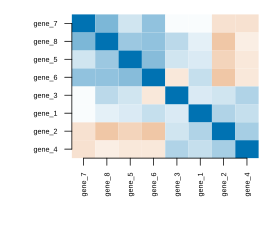

> Materials for this workshop were drafted with assistance from Claude (Anthropic) and reviewed and edited by the instructor.

## Setup

This document runs both R and Python chunks side by side. In Positron, make sure
you have both an R kernel and a Python (Jupyter) kernel available.

```{r}
#| label: setup-reticulate
#| include: false
# Pin reticulate to a specific conda environment BEFORE any other chunk runs.
# Without this, reticulate may auto-initialize its own managed Python (via uv)
# instead of whatever environment you've installed your packages into —
# causing "ModuleNotFoundError" even though packages are installed and
# importable when you test them interactively.
#
# Replace "workshop" with the name of your own conda environment if different.
reticulate::use_condaenv("workshop_arm", required = TRUE)
```

> **If this chunk errors** ("conda environment not found" or similar), run
> `conda env list` in a terminal to confirm the exact environment name, and
> update the string above to match. If you're using a plain venv instead of
> conda, use `reticulate::use_virtualenv("/path/to/.venv", required = TRUE)`
> instead.

### R packages needed

```{r}
#| label: setup-r
#| eval: false
install.packages(c(
  "tidyverse", "survival", "survminer", "patchwork",
  "ggpubr", "viridis", "forestplot", "gtsummary", "gt",
  "table1", "ggridges", "pROC"
))
```

### Python packages needed

```{python}
#| label: setup-py
#| eval: false
# pip install pandas numpy matplotlib seaborn lifelines statannotations scipy tableone scikit-learn statsmodels joypy
```

> **Setup gotcha — read before installing:** in Positron, R and Python can run
> as two *completely separate* Python environments. If you install packages by
> calling `reticulate::repl_python()` from the **R console**, that only
> installs into reticulate's own Python (managed via `uv`) — it will **not**
> be visible to Quarto's `{python}` chunks or to Positron's native Python
> console/kernel.
>
> To install packages for **this document**, run the `pip install` line above
> directly in one of these places instead:
>
> - Positron's **Python console** (select the Python interpreter/kernel in
>   the console picker, not R), or
> - A **terminal**, using the exact interpreter your Python kernel uses:
>   ```bash
>   # first, inside the Python console, find the right interpreter:
>   python -c "import sys; print(sys.executable)"
>   # then install using that exact path:
>   /path/from/above -m pip install pandas numpy matplotlib seaborn lifelines statannotations scipy tableone
>   ```
>
> After installing, **restart the Python kernel** (not just re-run the cell)
> so the newly installed packages are importable. If `import pandas` still
> fails after a restart, it's almost always because the install went into a
> different Python than the one the kernel is running — re-check
> `sys.executable` from inside the kernel to confirm you're installing into
> the right place.

---

## 1. Generate Synthetic Clinical Data

We'll simulate a small clinical trial dataset: patient demographics, a biomarker,
treatment arm, a continuous lab outcome, and survival/censoring data. This mirrors
the shape of real trial data without using any real patient information.

**Sample size:** 200 simulated patients

| Column | Type | Description |
|---|---|---|
| patient_id | ID | Sequential, e.g. PT-001 to PT-200 |
| arm | Categorical (2 levels) | Control or Treatment, randomly assigned ~50/50 |
| age | Continuous | Normally distributed, mean 58, SD 12 |
| sex | Categorical (2 levels) | Female (52%) / Male (48%) |
| site | Categorical (4 levels) | Site_1-Site_4, randomly assigned (Site_3 has a real effect baked in -- see Section 11.3 note) |
| smoker | Categorical (3 levels) | Never (50%), Former (30%), Current (20%) |
| biomarker | Continuous | Right-skewed (gamma distribution, shape 2, scale 15) |
| baseline_score | Continuous | Normally distributed, mean 50, SD 10 |
| followup_score | Continuous | Baseline score minus a treatment effect (Treatment arm drops ~8 points on average; Control drops ~1 point) |
| responder / response_label | Binary / Categorical | 1 = responder; higher response rate in Treatment (55%) vs. Control (30%) |
| time_months / event | Continuous / Binary | Simulated time-to-event and event/censoring indicator (65% event rate) |

Two companion datasets are generated later in the document: `longitudinal_data.csv`
(same 200 patients, measured at 4 visits — week 0, 4, 8, 12) and `pca_data.csv`
(same 200 patients with 6 synthetic correlated biomarkers, marker_1-marker_6).

### R version

| Column | Type | Description |
|---|---|---|
| patient_id | ID | Sequential, e.g. PT-001 to PT-200 |
| arm | Categorical (2 levels) | Control or Treatment, randomly assigned ~50/50 |
| age | Continuous | Normally distributed, mean 58, SD 12 |
| sex | Categorical (2 levels) | Female (52%) / Male (48%) |
| site | Categorical (4 levels) | Site_1-Site_4, randomly assigned |
| smoker | Categorical (3 levels) | Never (50%), Former (30%), Current (20%) |
| biomarker | Continuous | Right-skewed (gamma distribution, shape 2, scale 15) |
| baseline_score | Continuous | Normally distributed, mean 50, SD 10 |
| followup_score | Continuous | Baseline score minus a treatment effect (Treatment arm drops ~8 points on average; Control drops ~1 point) |
| responder / response_label | Binary / Categorical | 1 = responder; higher response rate in Treatment (55%) vs. Control (30%) |
| time_months / event | Continuous / Binary | Simulated time-to-event and event/censoring indicator (65% event rate) |

Two companion datasets are generated later in the document: `longitudinal_data.csv`
(same 200 patients, measured at 4 visits — week 0, 4, 8, 12) and `pca_data.csv`
(same 200 patients with 6 synthetic correlated biomarkers, marker_1-marker_6).

### R version

```{r}
#| label: gen-data-r
library(tidyverse)
set.seed(42)

n <- 200

clinical_r <- tibble(
  patient_id = sprintf("PT-%03d", 1:n),
  arm = sample(c("Control", "Treatment"), n, replace = TRUE),
  age = round(rnorm(n, mean = 58, sd = 12)),
  sex = sample(c("Female", "Male"), n, replace = TRUE, prob = c(0.52, 0.48)),
  site = sample(paste0("Site_", 1:4), n, replace = TRUE),
  smoker = sample(c("Never", "Former", "Current"), n, replace = TRUE, prob = c(0.5, 0.3, 0.2)),
  biomarker = rgamma(n, shape = 2, scale = 15),
  baseline_score = rnorm(n, mean = 50, sd = 10)
) %>%
  mutate(
    # Site-level effect baked in so the ANOVA/pairwise comparisons section
    # (Section 11.3) has something real to find -- Site_3 runs noticeably
    # lower than the others, Site_1/2/4 are similar to each other. Without
    # this, all 4 sites are statistically indistinguishable and the
    # pairwise-comparison plot has nothing significant to show.
    site_effect = case_when(
      site == "Site_3" ~ -9,
      TRUE ~ 0
    ),
    # Treatment effect: Treatment arm has lower follow-up score on average
    followup_score = baseline_score -
      ifelse(arm == "Treatment", rnorm(n, 8, 5), rnorm(n, 1, 5)) +
      site_effect,
    # Response outcome, loosely tied to arm (for chi-square/fisher demo)
    responder = ifelse(
      arm == "Treatment",
      rbinom(n, 1, 0.55),
      rbinom(n, 1, 0.30)
    ),
    response_label = factor(responder, labels = c("No Response", "Response")),
    # Survival time influenced by arm and age
    time_months = pmax(
      1,
      rexp(n, rate = 1 / (24 + ifelse(arm == "Treatment", 8, 0) - (age - 58) * 0.2))
    ),
    event = rbinom(n, 1, prob = 0.65)  # 1 = event occurred, 0 = censored
  ) %>%
  select(-site_effect)

write_csv(clinical_r, "clinical_trial_data.csv")
head(clinical_r)
```

### Python version (reads the same CSV for consistency)

```{python}
#| label: gen-data-py
import pandas as pd
import numpy as np
import matplotlib.pyplot as plt
import seaborn as sns

sns.set_theme(style="whitegrid", font_scale=1.0)

clinical_py = pd.read_csv("clinical_trial_data.csv")
clinical_py.head()
```

### Longitudinal data (for line chart section)

Many clinical questions involve repeated measures over time — e.g., a lab value
tracked at baseline, week 4, week 8, week 12. Let's simulate that too.

```{r}
#| label: gen-longitudinal-r
visits <- c(0, 4, 8, 12)

longitudinal_r <- clinical_r %>%
  select(patient_id, arm) %>%
  crossing(week = visits) %>%
  arrange(patient_id, week) %>%
  group_by(patient_id) %>%
  mutate(
    arm_effect = ifelse(first(arm) == "Treatment", -1.8, -0.3),
    score = 50 + arm_effect * week + rnorm(n(), 0, 4)
  ) %>%
  ungroup() %>%
  select(patient_id, arm, week, score)

write_csv(longitudinal_r, "longitudinal_data.csv")
head(longitudinal_r, 8)
```

```{python}
#| label: gen-longitudinal-py
longitudinal_py = pd.read_csv("longitudinal_data.csv")
longitudinal_py.head(8)
```

> **Teaching note:** generating data once in R and loading it in Python keeps both
> languages working on identical numbers, which makes side-by-side comparisons fair.

---

## 2. Choosing the Right Visualization

> **Before rendering this section:** run the chunk immediately below **once**
> (interactively, or it will run automatically during render) to generate the
> small illustrative example images referenced in this section. It creates an
> `images/` folder next to this `.qmd` and writes 8 small SVG files into it —
> no external packages needed beyond base R.

```{r}
#| label: generate-example-images
#| echo: false
#| include: false
#| results: hide
# NOTE: uses svglite instead of base R's svg() device, since svg() depends on
# Cairo/X11 libraries that are often missing on macOS (producing
# "failed to load cairo DLL" warnings and blank/broken output). svglite is a
# pure-R SVG device with no system dependencies.
# Run install.packages("svglite") once if not already installed.
library(svglite)

dir.create("images", showWarnings = FALSE)

svglite("images/example_boxplot.svg", width = 3.5, height = 2.4)
par(mar = c(3, 3, 1, 1))
set.seed(1)
boxplot(
  list(Control = c(35,40,44,48,50,52,55,58,62,65),
       Treatment = c(22,28,32,36,40,42,45,48,52,55)),
  col = adjustcolor(c("#440154", "#21908C"), alpha.f = 0.35),
  border = c("#440154", "#21908C"), outline = FALSE
)
stripchart(list(Control = c(35,40,44,48,50,52,55,58,62,65),
                 Treatment = c(22,28,32,36,40,42,45,48,52,55)),
           vertical = TRUE, method = "jitter", pch = 16,
           col = adjustcolor("black", 0.4), add = TRUE)
dev.off()

svglite("images/example_bar_meanSD.svg", width = 3.5, height = 2.4)
par(mar = c(3, 3, 1, 1))
means <- c(Control = 52, Treatment = 38); sds <- c(9, 8)
bp <- barplot(means, col = adjustcolor(c("#440154", "#21908C"), 0.5),
              border = c("#440154", "#21908C"), ylim = c(0, 75))
arrows(bp, means - sds, bp, means + sds, angle = 90, code = 3, length = 0.05)
dev.off()

svglite("images/example_histogram.svg", width = 3.5, height = 2.4)
par(mar = c(3, 3, 1, 1))
set.seed(2)
hist(rgamma(300, shape = 2, scale = 15), breaks = 15, col = "#3b528bcc",
     border = "white", main = "", xlab = "Biomarker level")
dev.off()

svglite("images/example_scatter_pca.svg", width = 3.5, height = 2.4)
par(mar = c(3, 3, 1, 1))
set.seed(3)
pc1a <- rnorm(18, 0.3, 0.15); pc2a <- rnorm(18, 0.6, 0.12)
pc1b <- rnorm(18, 0.7, 0.15); pc2b <- rnorm(18, 0.35, 0.12)
plot(c(pc1a, pc1b), c(pc2a, pc2b), col = rep(c("#440154", "#21908C"), each = 18),
     pch = 16, xlab = "PC1 (34.2% variance)", ylab = "PC2 (18.7% variance)")
dev.off()

svglite("images/example_linechart.svg", width = 3.5, height = 2.4)
par(mar = c(3, 3, 1, 1))
weeks <- c(0, 4, 8, 12)
plot(weeks, c(50,49,47,46), type = "o", col = "#440154", pch = 16,
     ylim = c(28, 54), xlab = "Week", ylab = "Score")
lines(weeks, c(50,44,38,33), type = "o", col = "#21908C", pch = 16)
dev.off()

svglite("images/example_km_curve.svg", width = 3.5, height = 2.4)
par(mar = c(3, 3, 1, 1))
plot(c(0,4,4,8,8,12,12,16,16,20,20,24), c(1,1,0.9,0.9,0.75,0.75,0.6,0.6,0.48,0.48,0.4,0.4),
     type = "l", col = "#440154", lwd = 2, xlab = "Time (months)", ylab = "Survival", ylim = c(0,1))
lines(c(0,4,4,8,8,12,12,16,16,20,20,24), c(1,1,0.95,0.95,0.88,0.88,0.8,0.8,0.74,0.74,0.68,0.68),
      col = "#21908C", lwd = 2)
dev.off()

svglite("images/example_forest_plot.svg", width = 3.5, height = 2.4)
par(mar = c(3, 7, 1, 1))
labels <- c("Overall", "Age<58", "Age>=58", "Female", "Male")
hr <- c(0.72, 0.65, 0.81, 0.70, 0.75); lo <- c(0.55,0.45,0.58,0.50,0.52); hi <- c(0.94,0.93,1.13,0.98,1.08)
plot(hr, 5:1, xlim = c(0.3, 1.4), ylim = c(0.5, 5.5), yaxt = "n", xlab = "Hazard Ratio",
     ylab = "", pch = 16, col = "#21908C", log = "x")
axis(2, at = 5:1, labels = labels, las = 2, cex.axis = 0.7)
arrows(lo, 5:1, hi, 5:1, angle = 90, code = 3, length = 0.03, col = "#333333")
abline(v = 1, lty = 2, col = "gray50")
dev.off()

svglite("images/example_stacked_bar.svg", width = 3.5, height = 2.4)
par(mar = c(3, 3, 1, 1))
m <- matrix(c(0.70, 0.45, 0.30, 0.55), nrow = 2,
            dimnames = list(c("No Response", "Response"), c("Control", "Treatment")))
barplot(m, col = c("#D55E00", "#009E73"), border = NA)
dev.off()

svglite("images/example_heatmap.svg", width = 3.8, height = 3.2)
set.seed(9)
# Simulate a small correlation matrix with some block structure, so
# clustering actually groups similar variables together visually.
vars <- paste0("gene_", 1:8)
base_mat <- matrix(rnorm(8 * 30), nrow = 30)
base_mat[, 1:4] <- base_mat[, 1:4] + matrix(rnorm(30), nrow = 30, ncol = 4) * 0.8
base_mat[, 5:8] <- base_mat[, 5:8] + matrix(rnorm(30), nrow = 30, ncol = 4) * 0.8
colnames(base_mat) <- vars
cor_mat <- cor(base_mat)

hc <- hclust(as.dist(1 - cor_mat))
ord <- hc$order
cor_ordered <- cor_mat[ord, ord]

par(mar = c(5, 5, 1, 1))
image(
  1:ncol(cor_ordered), 1:nrow(cor_ordered), t(cor_ordered)[, nrow(cor_ordered):1],
  col = colorRampPalette(c("#D55E00", "white", "#0072B2"))(50),
  zlim = c(-1, 1), axes = FALSE, xlab = "", ylab = ""
)
axis(1, at = 1:ncol(cor_ordered), labels = colnames(cor_ordered), las = 2, cex.axis = 0.6)
axis(2, at = 1:nrow(cor_ordered), labels = rev(rownames(cor_ordered)), las = 2, cex.axis = 0.6)
dev.off()

invisible(NULL)
```

> If the chunk above fails for any reason, the text explanations below still
> stand on their own — the images are illustrative supplements, not required
> for understanding the guidance.

Before writing any code, the most important decision is: *what type of data do
I have, and what question am I asking of it?* The wrong plot type for the data
structure is one of the most common (and most avoidable) reasons a figure gets
flagged in review. Use this as a decision reference, not a rulebook — there are
always exceptions, but these are solid defaults.

### Quick decision table

| Data type | Question being asked | Recommended plot |
|---|---|---|
| Continuous, 1 group | Distribution shape | Histogram, density plot |
| Continuous, 2 groups | Compare distributions | Boxplot + jitter, violin plot |
| Continuous, 3+ groups | Compare distributions | Boxplot/violin faceted or grouped |
| Continuous, paired/matched | Change within subject | Paired line plot (spaghetti plot) |
| Continuous x continuous | Relationship/correlation | Scatter plot (+ trend line) |
| Continuous over time | Trend / trajectory | Line chart (mean +/- SE/SD) |
| Time-to-event (censored) | Survival/time-to-event | Kaplan-Meier curve |
| Categorical x categorical | Association/proportions | Stacked or grouped bar, mosaic plot |
| Categorical, 1 variable | Counts/frequency | Bar chart |
| Effect sizes across subgroups | Compare estimates + CIs | Forest plot |
| High-dimensional (many genes/features) | Structure, clustering, batch effects | PCA/UMAP scatter, heatmap |

### Worked examples

**Boxplot — when you have continuous data split by a categorical grouping variable.**
Example: comparing a lab value (continuous) across 2–4 treatment arms
(categorical). The box shows median and IQR, whiskers show range (or 1.5×IQR),
and adding jittered points on top shows you the actual sample size and whether
the distribution is skewed or bimodal — something the box alone can hide. This
is almost always a better default than a bar chart of group means, because
a bar+error bar can look identical for very different underlying distributions
(e.g., bimodal vs. unimodal data can produce the same mean and SD).

{width=55%}

**Bar chart — when you have counts or proportions of categorical data**, or when
you specifically want to communicate a mean with its own important caveat: a
bar chart of means can be misleading because it visually implies the data
starts at zero and all the information is in the bar height. If you do use
mean ± SD/SE bars for continuous data (common in bench science), always
overlay individual data points so the reader can see the real distribution
underneath the summary statistic. Don't use bar charts for continuous
distributions when a boxplot or violin would preserve more information.

{width=55%}

**Histogram — when you want to see the full distribution shape of one
continuous variable.** Example: checking whether a biomarker is normally
distributed before deciding whether to use a t-test or a Wilcoxon test in your
Table 1. This is a diagnostic plot more than a publication plot, but it's
essential during analysis, before you pick which group-comparison test to run
downstream. A density plot (smoothed version) is the equivalent when you want
to overlay 2+ groups without the visual clutter of overlapping bars.

{width=55%}

**Scatter plot — when you have two continuous variables and want to show a
relationship.** Classic case: biomarker vs. outcome score. This is also the
right plot for **PCA results**: after dimensionality reduction, you plot PC1
(x) vs. PC2 (y), with each point representing a sample, colored by a metadata
variable (treatment group, batch, cell type, tumor subtype). The key
distinction from a generic scatter plot is that the axes themselves (PC1, PC2)
usually have a "% variance explained" label, since the axis is a composite
constructed dimension, not an original measured variable — e.g.
`PC1 (34.2% variance explained)`. Similarly, UMAP/t-SNE plots are visualized as
scatter plots but their axes are not interpretable on their own (no "% variance
explained," and distances between distant clusters aren't meaningful) — that
caveat is worth stating explicitly in a figure legend.

{width=55%}

**Line chart — when you have repeated measurements of a continuous variable
over an ordered variable**, almost always time. The line itself implies
continuity/trend, so only connect points that have a real ordering — never use
a line chart to connect categorical groups that have no inherent order (e.g.,
don't draw a line connecting "Site A -> Site B -> Site C" unless sites have a
genuine sequence).

{width=55%}

**Kaplan-Meier curve — specifically for time-to-event data with censoring**
(patients who left the study, were still alive at last follow-up, etc.).
Never substitute a boxplot of raw "time to event" values — that approach
silently drops or mishandles censored observations and will give you the
wrong answer, not just an ugly plot.

{width=55%}

**Forest plot — when you want to compare an effect size (hazard ratio, odds
ratio, mean difference) and its confidence interval across several subgroups
or studies at once.** This is preferred over a table of numbers when there are
more than ~4-5 subgroups, since the visual pattern (which subgroups cross the
null line) is much faster to parse than scanning a column of p-values.

{width=55%}

**Stacked/grouped bar chart — for categorical × categorical data**, such as
smoking status composition across trial sites. Use *stacked* when you care
about the whole (100% composition) and have few categories (2–3 is
comfortable, 4 is pushing it). Use *grouped* (bars side-by-side rather than
stacked) when you want the reader to compare one specific category's height
precisely across groups — stacking anything after the first segment makes
precise comparison hard, since the baseline for the second-and-later segments
keeps moving.

{width=55%}

**Heatmap — for high-dimensional continuous data** (e.g., gene expression
across samples, correlation matrices). Pair with hierarchical clustering on
rows/columns, and use a diverging colormap (not viridis) if the data has a
meaningful zero point (e.g., log fold-change, correlation coefficients from
-1 to 1).

{width=55%}

### A note on PCA / dimensionality-reduction plots specifically

Since many of you work with omics or high-dimensional feature data, a few
PCA-specific notes that go beyond "just use a scatter plot":

- Always report % variance explained in the axis label for the PCs you're
  plotting — this is standard practice and reviewers will ask for it if it's
  missing
- Color points by a meaningful metadata variable (condition, batch, cell
  type) — an uncolored PCA plot answers "is there structure?" but not "what's
  driving it?"
- If you're checking for batch effects, plot the same PCA colored by batch
  separately from the plot colored by biological condition — overlaying both
  as different shapes/colors in one panel usually gets visually noisy past 2
  categorical variables
- Consider a scree plot (bar chart of % variance explained per PC) as a
  companion figure, so readers can judge whether PC1 vs. PC2 captures most of
  the structure or whether later PCs still matter

---

## 3. Plot Parameters: A Quick Reference

Before diving into specific plot types, it's worth having one place that maps
out the common visual parameters you'll adjust across almost every plot in
this document. Once you know these, you can apply them to any plot type —
they're not specific to boxplots or scatter plots, they're general-purpose
knobs for presentation quality.

### Quick reference table

| Parameter | ggplot2 | Python (matplotlib/seaborn) | Typical publication value |
|---|---|---|---|
| Point size | `size =` in `geom_point()` | `s=` (matplotlib) / `size=` (sns) | 2-4 (small multi-panel), 4-8 (single figure) |
| Point shape/type | `shape =` (0-25, numeric codes) | `marker=` ('o', 's', '^', 'D', etc.) | Keep consistent per group across a paper |
| Point/line transparency | `alpha =` (0-1) | `alpha=` (0-1) | 0.5-0.8 for overlapping points; 1.0 for lines |
| Line type | `linetype =` ('solid','dashed','dotted') | `linestyle=` ('-', '--', ':', '-.') | Solid for primary data, dashed for reference/threshold lines |
| Line width | `linewidth =` (ggplot2 >= 3.4) | `linewidth=` (or `lw=`) | 0.5-1 for gridlines/reference, 1.5-2.5 for data lines |
| Figure size | `ggsave(width=, height=, units="in")` | `plt.subplots(figsize=(w,h))` | Match journal column width: ~3.5in (1-col) or ~7in (2-col) |
| Font size (base) | `theme_minimal(base_size = 12)` | `plt.rcParams['font.size'] = 12` | 8-10pt at final print size |
| Axis title size | `theme(axis.title = element_text(size=))` | `ax.set_xlabel(..., fontsize=)` | Slightly larger than axis tick labels |
| Legend position | `theme(legend.position = "top"/"right"/"none")` | `ax.legend(loc=, bbox_to_anchor=)` | "none" if only 1 group; "right" or "top" for 2+ |
| DPI (export) | `ggsave(dpi = 300)` | `plt.savefig(dpi=300)` | 300 minimum; 600 for line art/vector-heavy figures |

### Worked example: the same scatter plot, three parameter presets

To make this concrete, here's one scatter plot rendered three different ways —
purely by changing parameters, not the underlying data or plot type. This is
meant to show how much these settings change the feel of a figure.

**Preset A — "exploratory" (what you'd use while analyzing, not for
publication):** large default points, no transparency, default font sizes,
legend wherever matplotlib/ggplot2 puts it by default.

**Preset B — "presentation" (for a slide deck or talk):** larger points and
fonts for visibility from the back of a room, bolder lines, legend moved to a
clear position.

**Preset C — "publication" (for a journal figure):** smaller, restrained
point size appropriate for a dense figure, muted transparency to handle
overlapping points, conservative font sizing matched to the target print
column width, legend placed to not waste horizontal space.

#### R — three presets of the same plot

```{r}
#| label: param-presets-r
#| fig-width: 13
#| fig-height: 4.5
library(patchwork)

preset_exploratory <- ggplot(clinical_r, aes(biomarker, followup_score, color = arm)) +
  geom_point() +
  labs(title = "Exploratory\n(defaults)") +
  theme(plot.title = element_text(size = 10))

preset_presentation <- ggplot(clinical_r, aes(biomarker, followup_score, color = arm)) +
  geom_point(size = 4, alpha = 0.8) +
  scale_color_viridis_d(end = 0.8) +
  labs(title = "Presentation\n(slide-ready)") +
  theme_minimal(base_size = 13) +
  theme(legend.position = "bottom", plot.title = element_text(size = 12))

preset_publication <- ggplot(clinical_r, aes(biomarker, followup_score, color = arm)) +
  geom_point(size = 1.8, alpha = 0.6) +
  scale_color_viridis_d(end = 0.8) +
  labs(title = "Publication\n(print-ready)", color = NULL) +
  theme_minimal(base_size = 9) +
  theme(
    plot.title = element_text(size = 10),
    legend.position = "inside",
    legend.position.inside = c(0.8, 0.9),
    legend.background = element_rect(fill = "white", color = NA),
    legend.key.size = unit(0.35, "cm"),
    legend.text = element_text(size = 7)
  )

# Use patchwork's | operator to place three separate ggplot objects
# side-by-side. Plain "+" only adds layers/components to ONE ggplot object,
# it cannot combine multiple separate plots -- that's what patchwork is for.
# If the three panels still look cramped/overlapping in your render, increase
# fig-width further (each panel needs roughly 4+ inches of width to have
# room for its title, axis labels, and legend without crowding).
preset_exploratory | preset_presentation | preset_publication
```

#### Python — three presets of the same plot

```{python}
#| label: param-presets-py
#| fig-width: 10
#| fig-height: 4
import matplotlib.pyplot as plt
import seaborn as sns

fig, axes = plt.subplots(1, 3, figsize=(10, 4))

# Exploratory
sns.scatterplot(data=clinical_py, x="biomarker", y="followup_score", hue="arm", ax=axes[0])
axes[0].set_title("Exploratory (defaults)")

# Presentation
sns.scatterplot(data=clinical_py, x="biomarker", y="followup_score", hue="arm",
                 s=120, alpha=0.8, palette="viridis", ax=axes[1])
axes[1].set_title("Presentation (slide-ready)", fontsize=14)
axes[1].tick_params(labelsize=12)
axes[1].legend(loc="upper center", bbox_to_anchor=(0.5, 1.25), ncol=2, fontsize=10)

# Publication
sns.scatterplot(data=clinical_py, x="biomarker", y="followup_score", hue="arm",
                 s=25, alpha=0.6, palette="viridis", ax=axes[2])
axes[2].set_title("Publication (print-ready)", fontsize=9)
axes[2].tick_params(labelsize=7)
axes[2].set_xlabel(axes[2].get_xlabel(), fontsize=8)
axes[2].set_ylabel(axes[2].get_ylabel(), fontsize=8)
axes[2].legend(fontsize=6, markerscale=0.6, title=None, loc="upper right", frameon=True)

sns.despine()
plt.tight_layout()
plt.show()
```

> **Teaching note:** the "publication" preset's font sizes look almost too
> small on your laptop screen — that's expected and correct. Remember from
> the typography discussion: a figure that looks appropriately sized on a
> 15-inch laptop screen will almost always look oversized once placed in an
> actual journal column, because your screen is showing the plot at a much
> larger physical size than it will appear in print. Always sanity-check by
> exporting and viewing the actual output file at a realistic size, not just
> trusting how it looks in Positron's Plots pane.

> **A note on the legend choice above:** some publication figures do drop the
> legend entirely — relying on the figure caption to explain what each color
> represents, or because color is redundant with another visual cue (e.g.,
> panel position or a text label). That's a legitimate space-saving technique
> in the right context. But it's a confusing default for *this specific
> teaching example*, since without a legend a reader has no way to know what
> purple vs. teal actually means. A publication-ready figure still needs to
> communicate what its colors mean — it just does so efficiently (small,
> well-placed, minimal padding), rather than by omitting the legend
> altogether. That's why the publication preset above keeps a compact, in-plot
> legend rather than removing it.

### A note on consistency across a paper

Whatever preset you land on, the real rule is: **use the exact same
parameters across every figure in a single paper.** If Figure 1 uses point
size 2 and Figure 3 uses point size 5, a careful reviewer will notice the
inconsistency even if neither figure is wrong on its own. A simple way to
enforce this in code: define your preset once as a reusable theme/function,
and apply it everywhere.

```{r}
#| label: reusable-theme-r
#| eval: false
# Define once...
my_pub_theme <- theme_minimal(base_size = 9) + theme(legend.position = "none")

# ...reuse everywhere
ggplot(clinical_r, aes(biomarker, followup_score)) + geom_point(size = 1.8, alpha = 0.6) + my_pub_theme
```

```{python}
#| label: reusable-theme-py
#| eval: false
# Define once...
def apply_pub_style(ax, fontsize=9):
    ax.tick_params(labelsize=fontsize - 1)
    ax.set_xlabel(ax.get_xlabel(), fontsize=fontsize)
    ax.set_ylabel(ax.get_ylabel(), fontsize=fontsize)
    ax.set_title(ax.get_title(), fontsize=fontsize)

# ...reuse everywhere
fig, ax = plt.subplots()
sns.scatterplot(data=clinical_py, x="biomarker", y="followup_score", s=25, alpha=0.6, ax=ax)
apply_pub_style(ax)
```

---

## 4. Table 1: Summary Statistics with Group Comparison Tests

Almost every clinical paper opens with a "Table 1" — baseline characteristics by
group, with an appropriate statistical test per variable type:

- **Continuous variables** (age, biomarker): t-test or Wilcoxon/Mann-Whitney,
  depending on normality assumptions
- **Categorical variables** (sex, smoker status, responder): chi-square test,
  or Fisher's exact test when expected cell counts are small

### R — gtsummary (recommended)

`gtsummary` automatically picks a sensible default test per variable type and
produces a publication-ready table.

```{r}
#| label: table1-gtsummary-r
library(gtsummary)

clinical_r %>%
  select(arm, age, sex, smoker, biomarker, response_label) %>%
  tbl_summary(
    by = arm,
    statistic = list(
      all_continuous() ~ "{mean} ({sd})",
      all_categorical() ~ "{n} ({p}%)"
    ),
    digits = all_continuous() ~ 1
  ) %>%
  add_p(
    test = list(
      all_continuous() ~ "t.test",
      all_categorical() ~ "chisq.test"
    )
  ) %>%
  add_overall() %>%
  bold_labels()
```

> **Teaching note:** `add_p()` lets you specify the test per variable explicitly.
> If any categorical variable has small expected cell counts, swap in
> `"fisher.test"` for that variable instead of `"chisq.test"`.

### R — manual approach (if you want full control over which test runs)

```{r}
#| label: table1-manual-r
# Continuous: t-test (or wilcox.test if non-normal)
t_test_age <- t.test(age ~ arm, data = clinical_r)
wilcox_biomarker <- wilcox.test(biomarker ~ arm, data = clinical_r)

# Categorical: chi-square, with automatic fallback logic
sex_table <- table(clinical_r$sex, clinical_r$arm)
chisq_check <- chisq.test(sex_table)
if (any(chisq_check$expected < 5)) {
  sex_test <- fisher.test(sex_table)
  sex_test_name <- "Fisher's exact"
} else {
  sex_test <- chisq_check
  sex_test_name <- "Chi-square"
}

cat("Age t-test p-value:", round(t_test_age$p.value, 4), "\n")
cat("Biomarker Wilcoxon p-value:", round(wilcox_biomarker$p.value, 4), "\n")
cat("Sex test used:", sex_test_name, "- p-value:", round(sex_test$p.value, 4), "\n")
```

### Python — tableone

```{python}
#| label: table1-py
from tableone import TableOne

columns = ["age", "sex", "smoker", "biomarker", "response_label"]
categorical = ["sex", "smoker", "response_label"]

table1 = TableOne(
    clinical_py,
    columns=columns,
    categorical=categorical,
    groupby="arm",
    pval=True,
    htest_name=True
)

# Printed version (for the rendered HTML document / console output)
print(table1.tabulate(tablefmt="github"))

# DataFrame version (for Positron's Data Viewer / Variables pane)
# TableOne stores the underlying table with a MultiIndex on BOTH the rows
# (variable name, level) and the columns (e.g., ('Grouped by arm', 'Overall')).
# reset_index() on an unnamed row MultiIndex produces generic "level_0",
# "level_1" column names -- naming the index levels first avoids that.
table1_raw = table1.tableone.copy()
table1_raw.index = table1_raw.index.set_names(["Characteristic", "Level"])
table1_df = table1_raw.reset_index()
table1_df.columns = [
    '_'.join([str(c) for c in col if c not in ('', 'Grouped by arm')]).strip('_')
    for col in table1_df.columns.to_flat_index()
]

# Rendered HTML version (shows up inline in Positron's Plots/Viewer output area,
# the same way an R gt/gtsummary table does — not the raw-data Data Viewer grid).
# This works because Jupyter-based front ends (which Positron's Python chunks
# use) automatically render a DataFrame's _repr_html_() as rich output when
# it's the last expression in a cell.
# Note: caption text omits "Table 1." since Quarto adds its own table
# numbering/label automatically -- including it in both places duplicates it
# (e.g., "Table 1: Table 1. Baseline Characteristics by Arm").
table1_df.style.set_caption("Baseline Characteristics by Arm")
```

> **Two different things, two different views:**
>
> - `table1_df` on its own (no `.style`) → opens in Positron's **Data
>   Viewer** (the spreadsheet-style grid), same as any DataFrame — good for
>   sorting/filtering/inspecting values, but not styled like a publication table.
> - `table1_df.style.set_caption(...)` as the **last line of the cell** →
>   renders as a styled HTML table directly in Positron's **Plots/output
>   pane**, which is the Python equivalent of what `gt`/`gtsummary` give you
>   automatically in R. This is the one that will look like a real "Table 1."
>
> If you want both in one run, put `table1_df` on its own line earlier in the
> cell (so it's available in Variables/Data Viewer) and keep
> `table1_df.style...` as the final line (so the styled version renders in
> the output pane) — a cell only auto-displays its *last* expression, not
> every line.

### Python — manual approach (explicit test selection + Fisher fallback)

```{python}
#| label: table1-manual-py
from scipy.stats import ttest_ind, mannwhitneyu, chi2_contingency, fisher_exact

ctrl = clinical_py[clinical_py.arm == "Control"]
trt = clinical_py[clinical_py.arm == "Treatment"]

# Continuous: t-test and Mann-Whitney
t_stat, t_p = ttest_ind(ctrl["age"], trt["age"])
u_stat, u_p = mannwhitneyu(ctrl["biomarker"], trt["biomarker"])

# Categorical: chi-square with automatic Fisher fallback for small cells
contingency = pd.crosstab(clinical_py["sex"], clinical_py["arm"])
chi2, chi_p, dof, expected = chi2_contingency(contingency)

if (expected < 5).any():
    # Fisher's exact only supports 2x2 tables natively in scipy
    odds_ratio, fisher_p = fisher_exact(contingency)
    test_used, p_value = "Fisher's exact", fisher_p
else:
    test_used, p_value = "Chi-square", chi_p

print(f"Age t-test p-value: {t_p:.4f}")
print(f"Biomarker Mann-Whitney p-value: {u_p:.4f}")
print(f"Sex test used: {test_used} - p-value: {p_value:.4f}")
```

> **Teaching note:** the rule of thumb — chi-square needs expected cell counts
> ≥5 in every cell to be reliable; below that, switch to Fisher's exact. Both
> code paths above check this automatically rather than assuming.

---

## 5. Grammar of Graphics — Scatter Plot

**Goal:** biomarker (x) vs. follow-up score (y), colored by arm, faceted by site.

### R — ggplot2

```{r}
#| label: scatter-r
#| fig-width: 8
#| fig-height: 5
library(viridis)

p_scatter_r <- ggplot(clinical_r, aes(x = biomarker, y = followup_score, color = arm)) +
  geom_point(alpha = 0.7, size = 2) +
  geom_smooth(method = "lm", se = TRUE) +
  facet_wrap(~site) +
  scale_color_viridis_d(end = 0.8) +
  labs(
    x = "Biomarker Level (ng/mL)",
    y = "Follow-up Score",
    color = "Arm",
    title = "Biomarker vs. Follow-up Score by Site"
  ) +
  theme_minimal(base_size = 12)

p_scatter_r
```

### Python — seaborn

```{python}
#| label: scatter-py
#| fig-width: 8
#| fig-height: 5
import matplotlib.pyplot as plt
import seaborn as sns

sns.set_theme(style="whitegrid", font_scale=1.0)

g = sns.lmplot(
    data=clinical_py, x="biomarker", y="followup_score",
    hue="arm", col="site", col_wrap=2,
    palette="viridis", height=3, aspect=1.2,
    scatter_kws={"alpha": 0.7, "s": 30}
)
g.set_axis_labels("Biomarker Level (ng/mL)", "Follow-up Score")
g.fig.suptitle("Biomarker vs. Follow-up Score by Site", y=1.03)
g.fig.subplots_adjust(top=0.90)  # reserve space so the title doesn't overlap the top row of facets
plt.show()
```

---

## 6. Line Chart — Longitudinal / Repeated Measures

**Goal:** mean score over time by arm, with error bars (SD or SE), a very common
figure for tracking a lab value or score across visits.

### R — ggplot2

```{r}
#| label: linechart-r
#| fig-width: 7
#| fig-height: 5
summary_r <- longitudinal_r %>%
  group_by(arm, week) %>%
  summarise(
    mean_score = mean(score),
    sd_score = sd(score),
    se_score = sd_score / sqrt(n()),
    .groups = "drop"
  )

ggplot(summary_r, aes(x = week, y = mean_score, color = arm, group = arm)) +
  geom_line(linewidth = 1) +
  geom_point(size = 2.5) +
  geom_errorbar(
    aes(ymin = mean_score - se_score, ymax = mean_score + se_score),
    width = 0.5
  ) +
  scale_color_viridis_d(end = 0.8) +
  labs(
    x = "Week",
    y = "Mean Score (± SE)",
    color = "Arm",
    title = "Score Trajectory Over Time by Arm"
  ) +
  theme_minimal(base_size = 12)
```

### Python — matplotlib/seaborn

```{python}
#| label: linechart-py
#| fig-width: 7
#| fig-height: 5
summary_py = (
    longitudinal_py.groupby(["arm", "week"])["score"]
    .agg(mean_score="mean", sd_score="std", n="count")
    .reset_index()
)
summary_py["se_score"] = summary_py["sd_score"] / np.sqrt(summary_py["n"])

fig, ax = plt.subplots(figsize=(7, 5))
colors = {"Control": "#440154", "Treatment": "#21908C"}

for arm, color in colors.items():
    sub = summary_py[summary_py.arm == arm]
    ax.errorbar(
        sub["week"], sub["mean_score"], yerr=sub["se_score"],
        marker="o", capsize=4, label=arm, color=color, linewidth=2
    )

ax.set_xlabel("Week")
ax.set_ylabel("Mean Score (± SE)")
ax.set_title("Score Trajectory Over Time by Arm")
ax.legend(title="Arm")
sns.despine()
plt.tight_layout()
plt.show()
```

> **Teaching note:** SE vs. SD is a common point of confusion. SD describes
> spread of individual observations; SE describes uncertainty in the *mean*
> estimate and shrinks as sample size grows. Journals vary in which they
> expect — check author guidelines, and always label which one you plotted.

---

## 7. Density Plots

Density plots are a smoothed alternative to histograms — useful when you want
to compare distribution shape across groups without the visual clutter of
overlapping bars. We'll build up from a single density plot to multiple
overlaid groups to a ridgeline plot for many groups at once.

### 7.1 Single density plot

#### R — ggplot2

```{r}
#| label: density-single-r
#| fig-width: 6
#| fig-height: 4
ggplot(clinical_r, aes(x = biomarker)) +
  geom_density(fill = "#3b528b", alpha = 0.6) +
  labs(x = "Biomarker Level (ng/mL)", y = "Density", title = "Distribution of Biomarker Level") +
  theme_minimal(base_size = 12)
```

#### Python — seaborn

```{python}
#| label: density-single-py
#| fig-width: 6
#| fig-height: 4
fig, ax = plt.subplots(figsize=(6, 4))
sns.kdeplot(data=clinical_py, x="biomarker", fill=True, color="#3b528b", alpha=0.6, ax=ax)
ax.set_xlabel("Biomarker Level (ng/mL)")
ax.set_ylabel("Density")
ax.set_title("Distribution of Biomarker Level")
sns.despine()
plt.tight_layout()
plt.show()
```

### 7.2 Multiple-group overlaid density plot

Overlaying densities by group is a quick way to visually check whether two
groups' distributions look meaningfully different — and whether either looks
normally distributed, which informs your choice of statistical test (recall
Section 4's t-test vs. Wilcoxon decision).

#### R — ggplot2

```{r}
#| label: density-group-r
#| fig-width: 6
#| fig-height: 4
ggplot(clinical_r, aes(x = followup_score, fill = arm)) +
  geom_density(alpha = 0.5) +
  scale_fill_viridis_d(end = 0.8) +
  labs(x = "Follow-up Score", y = "Density", fill = "Arm",
       title = "Follow-up Score Distribution by Arm") +
  theme_minimal(base_size = 12)
```

#### Python — seaborn

```{python}
#| label: density-group-py
#| fig-width: 6
#| fig-height: 4
fig, ax = plt.subplots(figsize=(6, 4))
sns.kdeplot(data=clinical_py, x="followup_score", hue="arm", fill=True,
            common_norm=False, alpha=0.5, palette="viridis", ax=ax)
ax.set_xlabel("Follow-up Score")
ax.set_ylabel("Density")
ax.set_title("Follow-up Score Distribution by Arm")
sns.despine()
plt.tight_layout()
plt.show()
```

> **Teaching note:** by default, `ggplot2::geom_density()` normalizes each
> group's curve to integrate to 1 *independently*, while seaborn's
> `kdeplot()` defaults to `common_norm=True`, which normalizes all groups
> *jointly* — so a larger group's curve will appear taller relative to a
> smaller group's. Setting `common_norm=False` above makes seaborn match
> ggplot2's default behavior (each group's area under the curve = 1,
> regardless of sample size). Which behavior you actually want depends on
> your message: `common_norm=False` (ggplot2's default) is right when you
> want to compare *distribution shape* regardless of group size;
> `common_norm=True` is right when you also want the plot to convey *relative
> group size* (e.g., "there are more Control patients, so that density mass
> is visually larger"). Neither is "more correct" — just be explicit in your
> figure legend about which one you used.

> **Teaching note:** overlaid densities work well for 2-3 groups. Beyond
> that, overlapping fills become hard to distinguish even with transparency —
> that's exactly the problem a ridgeline plot (next) is designed to solve.

### 7.3 Ridgeline plot (many groups)

A ridgeline plot stacks each group's density curve on its own baseline,
slightly overlapping — this scales much better than overlaid densities once
you have more than ~4 groups, e.g., comparing a lab value across many trial
sites.

#### R — ggridges

```{r}
#| label: ridgeline-r
#| fig-width: 7
#| fig-height: 5
library(ggridges)

ggplot(clinical_r, aes(x = followup_score, y = site, fill = site)) +
  geom_density_ridges(alpha = 0.7, scale = 1.2) +
  scale_fill_viridis_d() +
  labs(x = "Follow-up Score", y = NULL, title = "Follow-up Score Distribution by Site") +
  theme_minimal(base_size = 12) +
  theme(legend.position = "none")
```

#### Python — joypy

```{python}
#| label: ridgeline-py
#| fig-width: 7
#| fig-height: 5
import joypy

fig, axes = joypy.joyplot(
    clinical_py,
    by="site",
    column="followup_score",
    colormap=plt.cm.viridis,
    alpha=0.7,
    figsize=(7, 5),
    title="Follow-up Score Distribution by Site"
)
plt.xlabel("Follow-up Score")
plt.show()
```

> **Teaching note:** `joypy` is a thin, purpose-built wrapper for exactly this
> plot type in Python — there isn't a native seaborn/matplotlib ridgeline, so
> this is one of the few places today where you'll reach for a smaller,
> less common package. If `joypy` isn't available in someone's environment,
> an acceptable fallback is a faceted density plot:
> `sns.FacetGrid(data, row="site").map(sns.kdeplot, "followup_score")` —
> not a true ridgeline (no overlap), but conveys similar information.

---

## 8. Kaplan-Meier Survival Curve

### R — survival + survminer

```{r}
#| label: km-r
#| fig-width: 7
#| fig-height: 5
library(survival)
library(survminer)

fit <- survfit(Surv(time_months, event) ~ arm, data = clinical_r)

ggsurvplot(
  fit,
  data = clinical_r,
  pval = TRUE,
  conf.int = TRUE,
  risk.table = TRUE,
  palette = c("#440154", "#21908C"),
  xlab = "Time (months)",
  ylab = "Survival Probability",
  legend.title = "Arm",
  ggtheme = theme_minimal(base_size = 12)
)
```

### Python — lifelines

```{python}
#| label: km-py
#| fig-width: 7
#| fig-height: 5
from lifelines import KaplanMeierFitter
from lifelines.statistics import logrank_test

fig, ax = plt.subplots(figsize=(7, 5))
kmf = KaplanMeierFitter()

for arm, color in colors.items():
    mask = clinical_py["arm"] == arm
    kmf.fit(
        clinical_py.loc[mask, "time_months"],
        clinical_py.loc[mask, "event"],
        label=arm
    )
    kmf.plot_survival_function(ax=ax, color=color, ci_show=True)

ax.set_xlabel("Time (months)")
ax.set_ylabel("Survival Probability")
ax.set_title("Kaplan-Meier Survival Curve by Arm")
sns.despine()
plt.tight_layout()
plt.show()

# Log-rank test
ctrl = clinical_py[clinical_py.arm == "Control"]
trt = clinical_py[clinical_py.arm == "Treatment"]
result = logrank_test(
    ctrl.time_months, trt.time_months,
    event_observed_A=ctrl.event, event_observed_B=trt.event
)
print(f"Log-rank p-value: {result.p_value:.4f}")
```

---

## 9. Forest Plot (Effect Sizes)

We'll simulate subgroup hazard ratios and build a forest plot — useful for
showing treatment effect across subgroups (age group, sex, site).

### R — manual ggplot2 build

```{r}
#| label: forest-r
#| fig-width: 7
#| fig-height: 5
forest_data_r <- tibble(
  subgroup = c("Overall", "Age under 58", "Age 58 plus", "Female", "Male"),
  hr = c(0.72, 0.65, 0.81, 0.70, 0.75),
  lower = c(0.55, 0.45, 0.58, 0.50, 0.52),
  upper = c(0.94, 0.93, 1.13, 0.98, 1.08)
) %>%
  mutate(subgroup = fct_rev(fct_inorder(subgroup)))

ggplot(forest_data_r, aes(x = hr, y = subgroup)) +
  geom_vline(xintercept = 1, linetype = "dashed", color = "gray50") +
  geom_errorbarh(aes(xmin = lower, xmax = upper), height = 0.2) +
  geom_point(size = 3, color = "#21908C") +
  scale_x_log10() +
  labs(
    x = "Hazard Ratio (log scale)",
    y = NULL,
    title = "Treatment Effect by Subgroup"
  ) +
  theme_minimal(base_size = 12)
```

### Python — manual matplotlib build

```{python}
#| label: forest-py
#| fig-width: 7
#| fig-height: 5
forest_data_py = pd.DataFrame({
    "subgroup": ["Overall", "Age under 58", "Age 58 plus", "Female", "Male"],
    "hr": [0.72, 0.65, 0.81, 0.70, 0.75],
    "lower": [0.55, 0.45, 0.58, 0.50, 0.52],
    "upper": [0.94, 0.93, 1.13, 0.98, 1.08],
})

fig, ax = plt.subplots(figsize=(7, 5))
y_pos = np.arange(len(forest_data_py))

ax.errorbar(
    forest_data_py["hr"], y_pos,
    xerr=[forest_data_py["hr"] - forest_data_py["lower"],
          forest_data_py["upper"] - forest_data_py["hr"]],
    fmt="o", color="#21908C", ecolor="black", capsize=4
)
ax.axvline(x=1, linestyle="--", color="gray")
ax.set_xscale("log")
ax.set_yticks(y_pos)
ax.set_yticklabels(forest_data_py["subgroup"])
ax.invert_yaxis()
ax.set_xlabel("Hazard Ratio (log scale)")
ax.set_title("Treatment Effect by Subgroup")
sns.despine()
plt.tight_layout()
plt.show()
```

---

---

## 10. ROC Curve and AUC

ROC (Receiver Operating Characteristic) curves evaluate how well a continuous
variable or model score discriminates between two outcome classes — common
for diagnostic biomarkers ("does this biomarker predict response?") or
classifier evaluation. The Area Under the Curve (AUC) summarizes overall
discriminative performance in a single number: 0.5 is no better than chance,
1.0 is perfect discrimination.

We'll use `biomarker` to predict `responder` as a worked example — i.e., "how
well does baseline biomarker level predict whether a patient responds?"

### R — pROC

```{r}
#| label: roc-r
#| fig-width: 6
#| fig-height: 6
library(pROC)

roc_obj_r <- roc(clinical_r$responder, clinical_r$biomarker, quiet = TRUE)
auc_val_r <- auc(roc_obj_r)

ggroc(roc_obj_r, color = "#21908C", linewidth = 1.2) +
  geom_abline(slope = 1, intercept = 1, linetype = "dashed", color = "gray50") +
  annotate("text", x = 0.3, y = 0.2, label = sprintf("AUC = %.3f", auc_val_r), size = 5) +
  labs(x = "Specificity", y = "Sensitivity", title = "ROC Curve: Biomarker Predicting Response") +
  theme_minimal(base_size = 12)
```

### Python — scikit-learn

```{python}
#| label: roc-py
#| fig-width: 6
#| fig-height: 6
from sklearn.metrics import roc_curve, auc

fpr, tpr, thresholds = roc_curve(clinical_py["responder"], clinical_py["biomarker"])
roc_auc = auc(fpr, tpr)

fig, ax = plt.subplots(figsize=(6, 6))
ax.plot(fpr, tpr, color="#21908C", linewidth=2.2, label=f"ROC curve (AUC = {roc_auc:.3f})")
ax.plot([0, 1], [0, 1], linestyle="--", color="gray")
ax.set_xlabel("1 - Specificity (False Positive Rate)")
ax.set_ylabel("Sensitivity (True Positive Rate)")
ax.set_title("ROC Curve: Biomarker Predicting Response")
ax.legend(loc="lower right")
sns.despine()
plt.tight_layout()
plt.show()
```

> **Teaching note:** R's `pROC::ggroc()` plots specificity decreasing
> left-to-right by default (so the plot reads "mirrored" compared to the more
> common Python/sklearn convention of plotting the false positive rate
> increasing left-to-right). Both are mathematically identical ROC curves —
> just check which x-axis convention your target journal expects, and be
> explicit about which one you're using in the axis label, since this is a
> common point of confusion when collaborators compare R and Python output.

> **Teaching note:** AUC alone doesn't tell you where to set a decision
> threshold for clinical use — that requires looking at the full
> sensitivity/specificity tradeoff along the curve, informed by the relative
> cost of false positives vs. false negatives in your specific clinical
> context. A high AUC with no discussion of threshold choice is incomplete
> for a clinical application, even though it's often sufficient for a purely
> descriptive "does this biomarker have signal" result.

---

## 11. Boxplot Variants with Statistical Annotation

We'll cover three common variants: boxplot with jittered points, mean ± SD bar
chart, and the statistical annotation on each.

### 11.1 Boxplot with jitter

#### R — ggpubr

```{r}
#| label: box-jitter-r
#| fig-width: 6
#| fig-height: 5
library(ggpubr)

ggplot(clinical_r, aes(x = arm, y = followup_score, fill = arm)) +
  geom_boxplot(alpha = 0.7, outlier.shape = NA) +
  geom_jitter(width = 0.15, alpha = 0.4) +
  stat_compare_means(
    method = "wilcox.test", label = "p.format",
    label.x = 1.5, hjust = 0.5
  ) +
  scale_fill_viridis_d(end = 0.8) +
  labs(x = NULL, y = "Follow-up Score", title = "Follow-up Score by Arm") +
  theme_minimal(base_size = 12) +
  theme(legend.position = "none")
```

#### Python — seaborn + statannotations (with fallback)

```{python}
#| label: box-jitter-py
#| fig-width: 6
#| fig-height: 5
try:
    from statannotations.Annotator import Annotator
    HAS_STATANNOTATIONS = True
except ImportError:
    HAS_STATANNOTATIONS = False

fig, ax = plt.subplots(figsize=(6, 5))
order = ["Control", "Treatment"]

sns.boxplot(
    data=clinical_py, x="arm", y="followup_score",
    order=order, palette="viridis", ax=ax
)
sns.stripplot(
    data=clinical_py, x="arm", y="followup_score",
    order=order, color="black", alpha=0.4, ax=ax
)

if HAS_STATANNOTATIONS:
    annotator = Annotator(ax, [("Control", "Treatment")],
                           data=clinical_py, x="arm", y="followup_score", order=order)
    annotator.configure(test="Mann-Whitney", text_format="simple")
    annotator.apply_and_annotate()
else:
    # Fallback: plain scipy stats + manual annotation
    from scipy.stats import mannwhitneyu

    grp_control = clinical_py.loc[clinical_py.arm == "Control", "followup_score"]
    grp_treatment = clinical_py.loc[clinical_py.arm == "Treatment", "followup_score"]
    stat, p_val = mannwhitneyu(grp_control, grp_treatment, alternative="two-sided")

    p_label = f"p = {p_val:.4f}" if p_val >= 0.0001 else "p < 0.0001"

    y_max = clinical_py["followup_score"].max()
    y_range = clinical_py["followup_score"].max() - clinical_py["followup_score"].min()
    bar_y = y_max + 0.05 * y_range
    text_y = bar_y + 0.02 * y_range

    ax.plot([0, 0, 1, 1], [bar_y, bar_y + 0.01 * y_range, bar_y + 0.01 * y_range, bar_y],
            lw=1.2, color="black")
    ax.text(0.5, text_y, p_label, ha="center", va="bottom", fontsize=10)
    ax.set_ylim(top=text_y + 0.08 * y_range)

ax.set_xlabel(None)
ax.set_ylabel("Follow-up Score")
ax.set_title("Follow-up Score by Arm")
sns.despine()
plt.tight_layout()
plt.show()
```

> **Teaching note:** if `statannotations` fails to import or conflicts with a newer
> seaborn version in someone's environment, the `try/except` above silently falls
> back to a manual Mann-Whitney test with a hand-drawn significance bracket — same
> statistical result, no extra dependency. Worth mentioning out loud during the
> session so people aren't confused by two different code paths producing the
> same plot.

### 11.2 Mean ± SD bar chart with significance stars

Journals often expect significance indicated directly on the plot using
asterisks rather than (or in addition to) a printed p-value: `*` p<0.05,
`**` p<0.01, `***` p<0.001, `ns` not significant. This mapping is a
convention, not a statistical standard — define it explicitly in your figure
legend regardless of which thresholds you use.

#### R — ggplot2 + ggpubr stars

```{r}
#| label: meanSD-stars-r
#| fig-width: 6
#| fig-height: 5
summary_stats_r <- clinical_r %>%
  group_by(arm) %>%
  summarise(
    mean_val = mean(followup_score),
    sd_val = sd(followup_score),
    .groups = "drop"
  )

test_result_r <- wilcox.test(followup_score ~ arm, data = clinical_r)
p_val_r <- test_result_r$p.value

stars_r <- case_when(
  p_val_r < 0.001 ~ "***",
  p_val_r < 0.01  ~ "**",
  p_val_r < 0.05  ~ "*",
  TRUE            ~ "ns"
)

y_bracket <- max(summary_stats_r$mean_val + summary_stats_r$sd_val) * 1.12

ggplot(summary_stats_r, aes(x = arm, y = mean_val, fill = arm)) +
  geom_col(alpha = 0.7, width = 0.6) +
  geom_errorbar(
    aes(ymin = mean_val - sd_val, ymax = mean_val + sd_val),
    width = 0.2
  ) +
  geom_jitter(
    data = clinical_r, aes(x = arm, y = followup_score),
    width = 0.1, alpha = 0.3, inherit.aes = FALSE
  ) +
  annotate("segment", x = 1, xend = 2, y = y_bracket, yend = y_bracket) +
  annotate("text", x = 1.5, y = y_bracket * 1.5, label = stars_r, size = 6) +
  scale_fill_viridis_d(end = 0.8) +
  labs(x = NULL, y = "Follow-up Score (Mean ± SD)", title = "Mean Follow-up Score by Arm") +
  theme_minimal(base_size = 12) +
  theme(legend.position = "none")
```

> **Teaching note:** `ggpubr::stat_compare_means(label = "p.signif")` can do
> this automatically in one line instead of the manual `annotate()` calls
> above — the manual version is shown here so you can see exactly how the
> star thresholds and bracket position are computed, which is useful once you
> need to customize it (e.g., different thresholds, multiple comparisons).

#### Python — matplotlib + manual stars

```{python}
#| label: meanSD-stars-py
#| fig-width: 6
#| fig-height: 5
from scipy.stats import mannwhitneyu

summary_stats_py = (
    clinical_py.groupby("arm")["followup_score"]
    .agg(mean_val="mean", sd_val="std")
    .reset_index()
)

grp_control = clinical_py.loc[clinical_py.arm == "Control", "followup_score"]
grp_treatment = clinical_py.loc[clinical_py.arm == "Treatment", "followup_score"]
stat, p_val = mannwhitneyu(grp_control, grp_treatment, alternative="two-sided")

def p_to_stars(p):
    if p < 0.001: return "***"
    elif p < 0.01: return "**"
    elif p < 0.05: return "*"
    else: return "ns"

stars_py = p_to_stars(p_val)

fig, ax = plt.subplots(figsize=(6, 5))
x_pos = np.arange(len(summary_stats_py))

ax.bar(
    x_pos, summary_stats_py["mean_val"],
    yerr=summary_stats_py["sd_val"], capsize=6,
    color=["#440154", "#21908C"], alpha=0.7, width=0.6
)

for i, arm in enumerate(summary_stats_py["arm"]):
    vals = clinical_py.loc[clinical_py.arm == arm, "followup_score"]
    jitter = np.random.normal(0, 0.04, size=len(vals))
    ax.scatter(np.full(len(vals), i) + jitter, vals, color="black", alpha=0.3, s=15)

y_bracket = (summary_stats_py["mean_val"] + summary_stats_py["sd_val"]).max() * 1.12
ax.plot([0, 0, 1, 1], [y_bracket, y_bracket*1.02, y_bracket*1.02, y_bracket], lw=1.2, color="black")
ax.text(0.5, y_bracket * 1.3, stars_py, ha="center", va="bottom", fontsize=14)

ax.set_xticks(x_pos)
ax.set_xticklabels(summary_stats_py["arm"])
ax.set_ylabel("Follow-up Score (Mean ± SD)")
ax.set_title("Mean Follow-up Score by Arm")
_ = ax.set_ylim(top=y_bracket * 1.15)
sns.despine()
plt.tight_layout()
plt.show()
```

> **Teaching note:** star thresholds (`*`, `**`, `***`) are a widely used
> convention but not universal — some journals want exact p-values instead,
> some want different thresholds. Always state your thresholds in the figure
> legend (e.g., "\*p<0.05, \*\*p<0.01, \*\*\*p<0.001, Mann-Whitney U test").

### 11.3 Three-group bar chart with ANOVA + pairwise comparisons

When comparing **3 or more groups**, a single Mann-Whitney/t-test isn't
appropriate — you need an omnibus test (ANOVA, or Kruskal-Wallis for
non-normal data) followed by corrected pairwise comparisons if the omnibus
test is significant. Here we compare `followup_score` across **site**
(4 groups).

> **Note on the synthetic data:** `Site_3` has a real, deliberately engineered
> effect baked into the data generation step in Section 1 — patients at
> Site_3 have a lower average `followup_score` than the other three sites,
> which are otherwise similar to each other. This is so the ANOVA/pairwise
> example below actually has something significant to find; with purely
> random, effect-free synthetic data, all 4 sites would be statistically
> indistinguishable and the pairwise-comparison plot would have no brackets to
> show, which makes for a poor teaching example. In your own real data, you
> obviously won't know the answer in advance — that's the point of running
> the test.

#### R — ggplot2 + ggpubr (ANOVA + Tukey HSD pairwise)

```{r}
#| label: anova-pairwise-r
#| fig-width: 7
#| fig-height: 5
# Omnibus test: one-way ANOVA across all 4 sites
anova_model <- aov(followup_score ~ site, data = clinical_r)
anova_summary <- summary(anova_model)
cat("ANOVA p-value:", format.pval(anova_summary[[1]][["Pr(>F)"]][1], digits = 4), "\n")

# Pairwise comparisons with Tukey's HSD (controls family-wise error rate)
tukey_result <- TukeyHSD(anova_model)
print(tukey_result)

# Build pairwise comparison list for ggpubr annotation
site_levels <- levels(factor(clinical_r$site))
comparisons_list <- combn(site_levels, 2, simplify = FALSE)

ggplot(clinical_r, aes(x = site, y = followup_score, fill = site)) +
  geom_boxplot(alpha = 0.7, outlier.shape = NA) +
  geom_jitter(width = 0.15, alpha = 0.3) +
  stat_compare_means(
    method = "anova",
    label.y = max(clinical_r$followup_score) * 1.15,
    label.x = (length(site_levels) + 1) / 2,
    hjust = 0.5
  ) +
  stat_compare_means(
    comparisons = comparisons_list,
    method = "t.test",
    label = "p.signif",
    step.increase = 0.08,
    hide.ns = TRUE
  ) +
  scale_fill_viridis_d(end = 0.8) +
  labs(x = NULL, y = "Follow-up Score", title = "Follow-up Score by Site") +
  theme_minimal(base_size = 12) +
  theme(legend.position = "none")
```

> **Teaching note:** `hide.ns = TRUE` hides brackets for non-significant
> pairwise comparisons, which keeps a 4-group plot (6 possible pairs) from
> becoming visually cluttered. Tukey's HSD is one standard way to correct for
> multiple comparisons; `stat_compare_means`'s pairwise `t.test` calls above
> are uncorrected by default — for a rigorous figure, extract corrected
> p-values from `tukey_result` instead and map them to custom labels if a
> reviewer will scrutinize multiple-comparison correction.

#### Python — matplotlib + scipy (ANOVA + Tukey HSD pairwise)

```{python}
#| label: anova-pairwise-py
#| fig-width: 7
#| fig-height: 5
from scipy.stats import f_oneway
from statsmodels.stats.multicomp import pairwise_tukeyhsd
import itertools

sites = sorted(clinical_py["site"].unique())
site_groups = [clinical_py.loc[clinical_py.site == s, "followup_score"] for s in sites]

# Omnibus test: one-way ANOVA across all 4 sites
f_stat, anova_p = f_oneway(*site_groups)
print(f"ANOVA p-value: {anova_p:.4f}")

# Pairwise comparisons with Tukey's HSD (controls family-wise error rate)
tukey = pairwise_tukeyhsd(
    endog=clinical_py["followup_score"],
    groups=clinical_py["site"],
    alpha=0.05
)
print(tukey.summary())

# Extract Tukey results into a lookup for star annotation
tukey_df = pd.DataFrame(
    data=tukey._results_table.data[1:],
    columns=tukey._results_table.data[0]
)

def p_to_stars(p):
    if p < 0.001: return "***"
    elif p < 0.01: return "**"
    elif p < 0.05: return "*"
    else: return None  # hide non-significant brackets

fig, ax = plt.subplots(figsize=(7, 5))
order = sites

sns.boxplot(data=clinical_py, x="site", y="followup_score", order=order, palette="viridis", ax=ax)
sns.stripplot(data=clinical_py, x="site", y="followup_score", order=order, color="black", alpha=0.3, ax=ax)

# Annotate ANOVA result at the top
y_max = clinical_py["followup_score"].max()
ax.text(
    (len(order) - 1) / 2, y_max * 1.3, f"ANOVA p = {anova_p:.4f}",
    ha="center", fontsize=10
)

# Add significant pairwise brackets only (keeps plot readable)
bracket_y = y_max * 1.05
step = (y_max * 0.08)
for _, row in tukey_df.iterrows():
    stars = p_to_stars(row["p-adj"])
    if stars is None:
        continue
    i, j = order.index(row["group1"]), order.index(row["group2"])
    ax.plot([i, i, j, j], [bracket_y, bracket_y+step*0.2, bracket_y+step*0.2, bracket_y], lw=1, color="black")
    ax.text((i+j)/2, bracket_y + step*0.25, stars, ha="center", fontsize=12)
    bracket_y += step

_ = ax.set_xlabel(None)
_ = ax.set_ylabel("Follow-up Score")
_ = ax.set_title("Follow-up Score by Site")
_ = ax.set_ylim(top=bracket_y + step)
sns.despine()
plt.tight_layout()
plt.show()
```

> **Teaching note:** `statsmodels.stats.multicomp.pairwise_tukeyhsd` already
> applies the Tukey correction for multiple comparisons, so `row["p-adj"]` is
> safe to use directly for star thresholds — unlike the uncorrected pairwise
> `t.test` calls in the R `stat_compare_means` example above. If you want the
> R version to also use corrected p-values for the star labels, extract them
> from `tukey_result` instead of relying on `stat_compare_means`'s default
> uncorrected pairwise tests.

---

## 12. Stacked Bar Plot (Categorical Proportions)

**Goal:** proportion of responders vs. non-responders by arm, and smoking status
composition by site — common ways to visualize categorical breakdowns.

### R — ggplot2

```{r}
#| label: stackedbar-r
#| fig-width: 6
#| fig-height: 5
response_summary_r <- clinical_r %>%
  count(arm, response_label) %>%
  group_by(arm) %>%
  mutate(prop = n / sum(n))

ggplot(response_summary_r, aes(x = arm, y = prop, fill = response_label)) +
  geom_col(position = "stack", width = 0.6) +
  geom_text(
    aes(label = scales::percent(prop, accuracy = 1)),
    position = position_stack(vjust = 0.5), color = "white", size = 4
  ) +
  scale_fill_manual(values = c("#D55E00", "#009E73")) +  # Okabe-Ito
  scale_y_continuous(labels = scales::percent) +
  labs(x = NULL, y = "Proportion", fill = NULL, title = "Response Rate by Arm") +
  theme_minimal(base_size = 12)
```

### Python — matplotlib

```{python}
#| label: stackedbar-py
#| fig-width: 6
#| fig-height: 5
response_summary_py = (
    clinical_py.groupby(["arm", "response_label"]).size()
    .unstack()
)
response_summary_py = response_summary_py.div(response_summary_py.sum(axis=1), axis=0)

okabe_ito_pair = ["#D55E00", "#009E73"]
fig, ax = plt.subplots(figsize=(6, 5))
response_summary_py.plot(kind="bar", stacked=True, color=okabe_ito_pair, ax=ax, width=0.6)

# Add percentage labels
for i, arm in enumerate(response_summary_py.index):
    cumulative = 0
    for col in response_summary_py.columns:
        val = response_summary_py.loc[arm, col]
        ax.text(i, cumulative + val / 2, f"{val:.0%}", ha="center", color="white", fontsize=10)
        cumulative += val

ax.set_xlabel(None)
ax.set_ylabel("Proportion")
ax.set_title("Response Rate by Arm")
ax.legend(title=None, bbox_to_anchor=(1.02, 1), loc="upper left")
ax.set_xticklabels(response_summary_py.index, rotation=0)
sns.despine()
plt.tight_layout()
plt.show()
```

> **Teaching note:** stacked bars are fine for 2–3 categories with a clear
> ordering (like response/no-response). For more than ~4 categories, consider
> a grouped bar chart instead — stacked segments beyond the first become hard
> to compare precisely since they don't share a common baseline.

---

## 13. PCA: Principal Component Plot and Biplot

PCA is a common first step for high-dimensional data (panels of biomarkers,
gene expression, lab panels) — it reduces many correlated features down to a
handful of components that capture most of the variance, which you can then
visualize as a 2D scatter plot.

### Generate synthetic multi-feature data

We'll simulate 6 correlated biomarkers measured on the same patients, with a
real (but modest) separation between treatment arms baked in, so the PCA has
something meaningful to find.

```{r}
#| label: gen-pca-data-r
set.seed(7)

n_biomarkers <- 6
biomarker_names <- paste0("marker_", 1:n_biomarkers)

# Build correlated biomarkers: start from a shared latent factor per patient,
# plus an arm-driven shift, plus individual noise per marker.
latent_factor <- rnorm(n)
arm_shift <- ifelse(clinical_r$arm == "Treatment", 1.2, -1.2)

pca_data_r <- clinical_r %>%
  select(patient_id, arm, site) %>%
  bind_cols(
    map_dfc(1:n_biomarkers, function(i) {
      tibble(!!biomarker_names[i] := latent_factor * runif(1, 0.4, 0.9) +
               arm_shift * runif(1, 0.2, 0.6) +
               rnorm(n, 0, 1))
    })
  )

write_csv(pca_data_r, "pca_data.csv")
head(pca_data_r)
```

```{python}
#| label: gen-pca-data-py
pca_data_py = pd.read_csv("pca_data.csv")
pca_data_py.head()
```

### PC score plot (PC1 vs. PC2, colored by arm)

#### R — prcomp + ggplot2

```{r}
#| label: pca-score-r
#| fig-width: 7
#| fig-height: 5
biomarker_cols <- paste0("marker_", 1:6)

pca_fit_r <- prcomp(pca_data_r[, biomarker_cols], center = TRUE, scale. = TRUE)

# % variance explained per PC
var_explained_r <- (pca_fit_r$sdev^2) / sum(pca_fit_r$sdev^2) * 100

pc_scores_r <- as_tibble(pca_fit_r$x) %>%
  bind_cols(pca_data_r %>% select(arm, site))

ggplot(pc_scores_r, aes(x = PC1, y = PC2, color = arm)) +
  geom_point(size = 2.5, alpha = 0.75) +
  stat_ellipse(level = 0.68) +
  scale_color_viridis_d(end = 0.8) +
  labs(
    x = sprintf("PC1 (%.1f%% variance)", var_explained_r[1]),
    y = sprintf("PC2 (%.1f%% variance)", var_explained_r[2]),
    color = "Arm",
    title = "PCA of Biomarker Panel"
  ) +
  theme_minimal(base_size = 12)
```

#### Python — scikit-learn + matplotlib

```{python}
#| label: pca-score-py
#| fig-width: 7
#| fig-height: 5
from sklearn.decomposition import PCA
from sklearn.preprocessing import StandardScaler

biomarker_cols = [f"marker_{i}" for i in range(1, 7)]
X = pca_data_py[biomarker_cols].values
X_scaled = StandardScaler().fit_transform(X)

pca = PCA(n_components=2)
pc_scores = pca.fit_transform(X_scaled)
var_explained = pca.explained_variance_ratio_ * 100

pc_df = pd.DataFrame(pc_scores, columns=["PC1", "PC2"])
pc_df["arm"] = pca_data_py["arm"].values

fig, ax = plt.subplots(figsize=(7, 5))
for arm_name, color in colors.items():
    sub = pc_df[pc_df.arm == arm_name]
    ax.scatter(sub["PC1"], sub["PC2"], color=color, alpha=0.75, s=40, label=arm_name)

_ = ax.set_xlabel(f"PC1 ({var_explained[0]:.1f}% variance)")
_ = ax.set_ylabel(f"PC2 ({var_explained[1]:.1f}% variance)")
_ = ax.set_title("PCA of Biomarker Panel")
ax.legend(title="Arm")
sns.despine()
plt.tight_layout()
plt.show()
```

> **Teaching note:** scaling (`scale. = TRUE` in R, `StandardScaler` in
> Python) matters a lot for PCA — without it, biomarkers measured on larger
> numeric scales will dominate the components purely due to units, not
> biological signal. Always scale unless your features are already on a
> comparable, meaningful common scale.

### Biplot (PC scores + loading vectors)

A biplot overlays the original variables' **loadings** (how much each
biomarker contributes to each PC, and in which direction) on top of the PC
score scatter plot — this tells you not just "the groups separate" but "which
biomarkers are driving that separation."

#### R — ggplot2 manual biplot

```{r}
#| label: pca-biplot-r
#| fig-width: 7
#| fig-height: 6
loadings_r <- as_tibble(pca_fit_r$rotation[, 1:2], rownames = "biomarker")

# Scale loading arrows to be visible alongside the score plot
scale_factor <- max(abs(pc_scores_r$PC1), abs(pc_scores_r$PC2)) * 0.8

ggplot() +
  geom_point(data = pc_scores_r, aes(x = PC1, y = PC2, color = arm), size = 2, alpha = 0.6) +
  geom_segment(
    data = loadings_r,
    aes(x = 0, y = 0, xend = PC1 * scale_factor, yend = PC2 * scale_factor),
    arrow = arrow(length = unit(0.2, "cm")), color = "#D55E00"
  ) +
  geom_text(
    data = loadings_r,
    aes(x = PC1 * scale_factor * 1.15, y = PC2 * scale_factor * 1.15, label = biomarker),
    color = "#D55E00", size = 3.5, fontface = "bold"
  ) +
  scale_color_viridis_d(end = 0.8) +
  labs(
    x = sprintf("PC1 (%.1f%% variance)", var_explained_r[1]),
    y = sprintf("PC2 (%.1f%% variance)", var_explained_r[2]),
    color = "Arm",
    title = "PCA Biplot: Scores + Biomarker Loadings"
  ) +
  theme_minimal(base_size = 12)
```

#### Python — matplotlib manual biplot

```{python}
#| label: pca-biplot-py
#| fig-width: 7
#| fig-height: 6
loadings = pca.components_.T[:, :2]  # shape: (n_biomarkers, 2)
scale_factor = np.abs(pc_scores).max() * 0.8

fig, ax = plt.subplots(figsize=(7, 6))

for arm_name, color in colors.items():
    sub = pc_df[pc_df.arm == arm_name]
    ax.scatter(sub["PC1"], sub["PC2"], color=color, alpha=0.6, s=35, label=arm_name)

# Track the full extent of every arrow endpoint (with label padding), so we
# can expand the axis limits to fit them -- by default matplotlib only sizes
# axes to the scatter points, so a long loading arrow/label can get clipped
# even though it's being drawn correctly.
arrow_endpoints_x = []
arrow_endpoints_y = []

for i, marker_name in enumerate(biomarker_cols):
    x_end = loadings[i, 0] * scale_factor
    y_end = loadings[i, 1] * scale_factor

    ax.annotate(
        "", xy=(x_end, y_end), xytext=(0, 0),
        arrowprops=dict(arrowstyle="->", color="#D55E00", lw=1.5)
    )
    label_x, label_y = x_end * 1.15, y_end * 1.15
    ax.text(label_x, label_y, marker_name, color="#D55E00",
            fontsize=9, fontweight="bold", ha="center")

    arrow_endpoints_x.append(label_x)
    arrow_endpoints_y.append(label_y)

# Expand axis limits to include all arrow/label endpoints plus the scatter
# points already plotted, with a small margin so nothing sits flush at the edge.
all_x = list(pc_df["PC1"]) + arrow_endpoints_x
all_y = list(pc_df["PC2"]) + arrow_endpoints_y
x_margin = (max(all_x) - min(all_x)) * 0.1
y_margin = (max(all_y) - min(all_y)) * 0.1
_ = ax.set_xlim(min(all_x) - x_margin, max(all_x) + x_margin)
_ = ax.set_ylim(min(all_y) - y_margin, max(all_y) + y_margin)

_ = ax.set_xlabel(f"PC1 ({var_explained[0]:.1f}% variance)")
_ = ax.set_ylabel(f"PC2 ({var_explained[1]:.1f}% variance)")
_ = ax.set_title("PCA Biplot: Scores + Biomarker Loadings")
ax.legend(title="Arm")
sns.despine()
plt.tight_layout()
plt.show()
```

> **Teaching note:** in a biplot, arrow **direction** shows which PCs a
> variable contributes to, and arrow **length** shows how strongly it
> contributes overall. Two arrows pointing the same direction indicate
> positively correlated variables; arrows pointing in opposite directions
> indicate negatively correlated variables; arrows at roughly 90° indicate
> little correlation between those two variables.

### Scree plot (companion figure)

```{r}
#| label: scree-r
#| fig-width: 6
#| fig-height: 4
scree_df_r <- tibble(
  PC = factor(paste0("PC", 1:length(var_explained_r)), levels = paste0("PC", 1:length(var_explained_r))),
  variance = var_explained_r,
  cumulative = cumsum(var_explained_r)
)

ggplot(scree_df_r, aes(x = PC)) +
  geom_col(aes(y = variance), fill = "#21908C", alpha = 0.8) +
  geom_line(aes(y = cumulative, group = 1), color = "#D55E00", linewidth = 1) +
  geom_point(aes(y = cumulative), color = "#D55E00", size = 2) +
  geom_text(aes(y = variance, label = sprintf("%.1f%%", variance)), vjust = -0.8, size = 3) +
  geom_text(aes(y = cumulative, label = sprintf("%.0f%%", cumulative)),
            vjust = -1, size = 3, color = "#D55E00") +
  scale_y_continuous(limits = c(0, 105)) +
  labs(x = NULL, y = "% Variance Explained",
       title = "Scree Plot",
       subtitle = "Bars: individual PC variance  |  Line: cumulative variance") +
  theme_minimal(base_size = 12)
```

```{python}
#| label: scree-py
#| fig-width: 6
#| fig-height: 4
pca_full = PCA().fit(X_scaled)
var_explained_full = pca_full.explained_variance_ratio_ * 100
cumulative_full = np.cumsum(var_explained_full)

fig, ax = plt.subplots(figsize=(6, 4))
pcs = [f"PC{i+1}" for i in range(len(var_explained_full))]
ax.bar(pcs, var_explained_full, color="#21908C", alpha=0.8, label="Individual")
ax.plot(pcs, cumulative_full, color="#D55E00", marker="o", linewidth=2, label="Cumulative")

for i, v in enumerate(var_explained_full):
    ax.text(i, v + 2, f"{v:.1f}%", ha="center", fontsize=8)
for i, v in enumerate(cumulative_full):
    ax.text(i, v + 2, f"{v:.0f}%", ha="center", fontsize=8, color="#D55E00")

_ = ax.set_ylabel("% Variance Explained")
_ = ax.set_title("Scree Plot\nBars: individual PC variance  |  Line: cumulative variance", fontsize=10)
_ = ax.set_ylim(0, 110)
ax.legend(loc="center right")
sns.despine()
plt.tight_layout()
plt.show()
```

### A note on PCA / dimensionality-reduction plots specifically

Since many of you work with omics or high-dimensional feature data, a few
PCA-specific notes that go beyond "just use a scatter plot":

- Always report % variance explained in the axis label for the PCs you're
  plotting — this is standard practice and reviewers will ask for it if it's
  missing
- Color points by a meaningful metadata variable (condition, batch, cell
  type) — an uncolored PCA plot answers "is there structure?" but not "what's
  driving it?"
- If you're checking for batch effects, plot the same PCA colored by batch
  separately from the plot colored by biological condition — overlaying both
  as different shapes/colors in one panel usually gets visually noisy past 2
  categorical variables
- Consider a scree plot (bar chart of % variance explained per PC) as a
  companion figure, so readers can judge whether PC1 vs. PC2 captures most of
  the structure or whether later PCs still matter

---

## 14. Multi-Panel Publication Figure

### R — patchwork

```{r}
#| label: panel-r
#| fig-width: 10
#| fig-height: 8
library(patchwork)

p1 <- ggplot(clinical_r, aes(biomarker, followup_score, color = arm)) +
  geom_point(alpha = 0.6) + scale_color_viridis_d(end = 0.8) +
  theme_minimal(base_size = 10) + labs(title = "A", x = "Biomarker", y = "Score")

p2 <- ggplot(clinical_r, aes(arm, followup_score, fill = arm)) +
  geom_boxplot(alpha = 0.7) + scale_fill_viridis_d(end = 0.8) +
  theme_minimal(base_size = 10) + theme(legend.position = "none") +
  labs(title = "B", x = NULL, y = "Score")

p3 <- ggplot(clinical_r, aes(age)) +
  geom_histogram(bins = 20, fill = "#21908C", alpha = 0.8) +
  theme_minimal(base_size = 10) + labs(title = "C", x = "Age", y = "Count")

(p1 | p2) / p3 + plot_layout(guides = "collect")
```

### Python — gridspec

```{python}
#| label: panel-py
#| fig-width: 10
#| fig-height: 8
fig = plt.figure(figsize=(10, 8))
gs = fig.add_gridspec(2, 2)

ax1 = fig.add_subplot(gs[0, 0])
sns.scatterplot(data=clinical_py, x="biomarker", y="followup_score", hue="arm",
                 palette="viridis", alpha=0.6, ax=ax1, legend=False)
ax1.set_title("A")

ax2 = fig.add_subplot(gs[0, 1])
sns.boxplot(data=clinical_py, x="arm", y="followup_score", palette="viridis", ax=ax2)
ax2.set_title("B")
ax2.set_xlabel(None)

ax3 = fig.add_subplot(gs[1, :])
sns.histplot(data=clinical_py, x="age", bins=20, color="#21908C", ax=ax3)
ax3.set_title("C")

sns.despine()
plt.tight_layout()
plt.show()
```

---

## 15. Exporting for Publication

### R

```{r}
#| label: export-r
#| eval: false
ggsave(
  "figure1_km_curve.pdf",
  plot = last_plot(),
  width = 7, height = 5, units = "in", dpi = 300
)

ggsave(
  "figure1_km_curve.tiff",
  plot = last_plot(),
  width = 7, height = 5, units = "in", dpi = 300, compression = "lzw"
)
```

### Python

```{python}
#| label: export-py
#| eval: false
fig.savefig("figure1_km_curve.pdf", dpi=300, bbox_inches="tight")
fig.savefig("figure1_km_curve.tiff", dpi=300, bbox_inches="tight", pil_kwargs={"compression": "tiff_lzw"})
```

---

## 16. Practice Exercise (20 min)

Using `clinical_trial_data.csv`, `longitudinal_data.csv`, and `pca_data.csv`,
pick **one** of the following and build a publication-ready version in your
language of choice:

1. A Table 1 comparing baseline characteristics by arm, with appropriate tests
   per variable type
2. A density plot or ridgeline plot comparing a continuous variable across
   groups
3. A Kaplan-Meier curve comparing arms, with a risk table
4. A forest plot showing hazard ratios across 3+ subgroups of your choosing
5. An ROC curve with AUC for biomarker predicting responder status
6. A line chart of score trajectory over time by arm, with error bars
7. An annotated boxplot/violin or mean±SD bar (with significance stars)
   comparing `baseline_score` vs `followup_score` across `site`
8. A stacked bar chart of `smoker` status composition by `site`
9. A PCA score plot or biplot of the biomarker panel, colored by arm

**Checklist before you're done:**

- [ ] Colorblind-safe palette
- [ ] Axis labels with units where relevant
- [ ] Consistent theme
- [ ] Correct statistical test for the variable type (if applicable)
- [ ] Exported at 300 DPI in both PDF (vector) and PNG/TIFF (raster)

---

## Appendix: Quick Reference Table

| Task | R | Python |
|---|---|---|
| Summary table + tests | gtsummary::tbl_summary | tableone.TableOne |
| Chi-square / Fisher | chisq.test / fisher.test | scipy.stats.chi2_contingency / fisher_exact |
| Continuous group test | t.test / wilcox.test | scipy.stats.ttest_ind / mannwhitneyu |
| ANOVA + pairwise | aov + TukeyHSD | scipy.stats.f_oneway + statsmodels pairwise_tukeyhsd |
| Scatter | geom_point | sns.scatterplot |
| Density plot | geom_density | sns.kdeplot |
| Ridgeline plot | ggridges::geom_density_ridges | joypy.joyplot |
| Line chart (mean +/- error) | geom_line + geom_errorbar | ax.errorbar |
| Survival curve | survminer::ggsurvplot | lifelines.KaplanMeierFitter |
| ROC curve + AUC | pROC::roc + ggroc | sklearn.metrics.roc_curve + auc |
| Forest plot | manual ggplot2 | manual matplotlib |
| Boxplot + jitter | geom_boxplot + geom_jitter | sns.boxplot + sns.stripplot |
| Mean +/- SD bar + stars | geom_col + geom_errorbar + annotate | ax.bar + yerr + ax.text |
| Boxplot + stats | ggpubr::stat_compare_means | statannotations.Annotator |
| Stacked bar | geom_col(position="stack") | df.plot(kind="bar", stacked=True) |
| PCA | prcomp | sklearn.decomposition.PCA |
| Multi-panel | patchwork | matplotlib.gridspec |
| Colorblind palette | scale_color_viridis_d | palette="viridis" |
| Export vector | ggsave(device="pdf") | savefig(format="pdf") |

---

## Appendix: Color Palette Sources

Both palettes used throughout this document are chosen deliberately for
accessibility and are standard in biomedical publishing — not arbitrary
aesthetic choices.

### Viridis (used for continuous/ordered data)

- Designed by Stéfan van der Walt and Nathaniel Smith for matplotlib in 2015,
  as one of four candidate perceptually uniform colormaps (magma, inferno,
  plasma, viridis)
- Became matplotlib's default colormap in version 2.0
- Perceptually uniform, monotonically increasing in luminance (so it still
  reads correctly in grayscale/photocopy), and built to remain legible under
  common forms of color vision deficiency
- Source: <https://bids.github.io/colormap/>
- R: `viridis` package, or `scale_color_viridis_d()` / `scale_color_viridis_c()`
  in ggplot2
- Python: built into matplotlib/seaborn — `palette="viridis"` or `cmap="viridis"`

### Okabe-Ito (used for categorical data: arms, subgroups)

- Proposed by Masataka Okabe (Jikei Medical School) and Kei Ito (University of
  Tokyo), 2008: *"Color Universal Design (CUD): How to make figures and
  presentations that are friendly to colorblind people"*
- An empirically-chosen 8-color qualitative palette that stays distinguishable
  across the most common forms of color blindness
- Popularized further by Bang Wong's 2011 *Nature Methods* commentary,
  "Points of view: Color blindness" (doi:10.1038/nmeth.1618) — hence it's
  sometimes called the "Wong palette"
- R: available in base R 4.0+ via `palette.colors()`, and natively in
  ggplot2 ≥ 3.4.0 via `scale_color_okabeito()` (from the `see` or similar
  extension packages)
- Python: no built-in name, define manually:

```{python}
#| label: okabe-ito-py
#| eval: false
okabe_ito = ['#E69F00', '#56B4E9', '#009E73', '#F0E442',
             '#0072B2', '#D55E00', '#CC79A7', '#000000']
import matplotlib.pyplot as plt
plt.rcParams['axes.prop_cycle'] = plt.cycler(color=okabe_ito)
# or: sns.set_palette(okabe_ito)
```

**Rule of thumb for this workshop:** viridis for anything continuous
(biomarker levels, scores, expression values), Okabe-Ito for anything
categorical (treatment arm, sex, subgroup). This matches the convention used
across Nature-family journals and is a safe default when you don't know your
reviewers' or readers' color vision status.